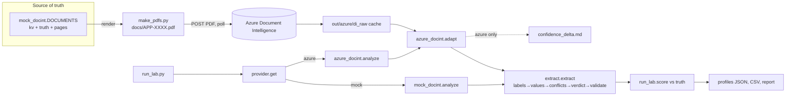

# Project Analysis — Sprint 1 · Day 14 Lab: Document Intelligence Field Extraction (DecisionStream AI)

> **Report type:** repository analysis, learning guide and Excel-ready record.
> **Analysis date:** 2026-10-11.
> **Method:** static reading of every Python file plus review of the generated files in `out/`. **No code was executed by the analyst for this report.** The one source edit made earlier in this session (a 429 retry, see §15 F-08) is disclosed there.
> **Evidence labels used throughout:** `Source-observed` · `Execution-verified` · `Code-derived expectation — not executed` · `Inference` · `Proposed improvement`.
> "Execution-verified" in this report means: confirmed by output files that a run of the lab produced (`out/mock/…`, `out/azure/…`, timestamps 2026-10-11 13:39–13:42). I did not see the console logs, so which command produced each file is itself an inference (§18, U-01).

---

# PART I — PROJECT AND BUSINESS UNDERSTANDING

## 3. Project identity and executive summary

| Item | Value |
|---|---|
| Project name | Sprint 1 · Day 14 Lab — Document Intelligence Field Extraction (banner: "DecisionStream AI — Document Intelligence extraction lab") |
| Project ID | **PRJ-FDE-S1D14-DOCINT** — *provisional*; no existing inventory/register was found in the repository, so this ID is invented and should be replaced if you keep a register |
| Repository path | `C:\Users\Admin\Desktop\FDEProgram\Codes\RunCompleted\Assignment3` (not a git repository) |
| Project type | Instructor-authored training lab (course exercise), Python command-line application, standard library only |
| Origin | README banner: "Birlasoft FORGE FDE Academy · Confidential — For Learner Use Only" (Source-observed, `README.md:3`) |
| Domain | Motor-insurance claims intake; document AI; AI Field Engineering (FDE) |
| Intended users | FDE learners; in the lab's story, the stakeholders are a claims-handling team at a fictional insurer "DecisionStream AI" |
| Main technologies | Python ≥3.9 (stdlib only: `argparse`, `csv`, `json`, `re`, `dataclasses`, `urllib`), Azure AI Document Intelligence REST API (`prebuilt-layout`, api-version 2024-11-30), hand-written PDF writer |
| Primary capability demonstrated | A **vendor-boundary (adapter) pattern** around an OCR/key-value service, plus a **confidence-policy + validation pipeline** that shows a confidence threshold alone lets wrong values through |
| Maturity | Teaching prototype with a deliberately engineered dataset. Not a production system (Inference: no auth, no persistence, no deployment code, no Azure Function code — the README only *describes* the Function). |
| Execution / test status | Output files from a mock run and an Azure run exist (Execution-verified, artifact evidence). The offline self-test (`--selftest`) result has **not** been supplied → `Pending user execution`. |
| Most important limitation | The Azure run was on the free **F0** tier, which read only 2 pages per document, so three of the lab's ten teaching points (APP-0005 conflict, APP-0007 identity page, APP-0010 page 3) did not reach the pipeline (§12, §15). |
| Most valuable learning opportunity | Seeing, with numbers, that **validation (pattern/cross-field checks) removed the wrong acceptances while tighter thresholds removed none** — then discovering on real data where that conclusion partly breaks. |

**Plain-language summary.** Ten fake motor-insurance claim forms are turned into structured "decision profiles". An OCR service (Azure Document Intelligence, or a built-in fake of it) reads each form and returns label→value pairs with a confidence number. The lab maps the form's own wording ("D.O.B.", "Reg No") to fixed field names, cleans the values (dates, money, IDs), then decides per field: *accept*, *flag for a human*, or *reject*. It then scores itself against known ground truth to answer one question: **how many wrong values did we accept without a warning?**

## 4. Business problem and value

**Scenario (course-constructed, not a real deployment).** *Source-observed:* the code and README model "DecisionStream AI — Motor Claims Intake" (`make_pdfs.py:182`), with 4,000 documents a month used as a sizing figure in the README checklist (`README.md:547`). This is an illustrative scenario in a training course; no real customer, savings or production adoption is documented, and none is claimed here.

| Aspect | Explanation |
|---|---|
| Workflow | Customers submit paper/PDF case application forms → data is keyed into a claims/decision system → an underwriter or handler decides. The lab automates the keying step. |
| Stakeholders | Claims handlers (review queue), the customer (hurt by wrong data), compliance/regulator (identity data, audit trail), the FDE engineer who must justify thresholds to a client. |
| Problem | Manual keying is slow, but naive automation ("accept if OCR confidence > 0.85") silently accepts wrong values: OCR confidence measures how sure the model is about what it *saw*, not whether the value is *correct*. |
| Cost of leaving it unresolved | A wrong policy number attaches a claim to a policy that does not exist; a wrong total or date alters a decision; nobody notices until downstream (README: "a rework cycle, a complaint, or a regulatory finding" — Source-observed claim, unquantified). |
| How the lab addresses it | Per-field thresholds, pattern checks, cross-field arithmetic/date checks, conflict surfacing, ambiguous-date refusal, and an identity-document scope gate. |
| Potential value | Fewer silent errors for a known review-queue cost. *Potential only.* |
| Limitations | Synthetic data, 10 documents, digital (not scanned) PDFs in the Azure path, no handwriting, no real-world calibration. |
| How value could be measured | Wrong-accepted rate (the lab's own headline metric), flag rate × handler seconds (README uses "thirty seconds per flag" as an assumption, not a measurement), straight-through-processing rate, rework rate on a real client sample. None are measured in this repo beyond the lab's own counts. |

*Documented requirement:* "`>0.85` accept, otherwise flag" (extract.py docstring, README). *Reasonable interpretation:* the lab's job is to show why that brief is insufficient.

## 5. Technical and educational problem

**Technical challenge.** Turn semi-structured, vendor-specific OCR output into a trustworthy, schema-conformant record, *and* keep the vendor swappable.

**Why a simple implementation is insufficient.** (1) Form labels vary ("Sum Ins." vs "Sum Insured"). (2) OCR errors are confident (`O`↔`0`). (3) Some failures produce no error at all (missing fields, free-tier page truncation, `features=keyValuePairs` omitted). (4) Business rules (totals must add up) are invisible to a confidence score.

**Concepts and how far they are implemented**

| Concept | Status | Evidence |
|---|---|---|
| Adapter / vendor boundary | **Implemented** | `provider.py`, `azure_docint.adapt()` |
| Confidence thresholds (flat & per-field bands) | **Implemented** | `extract.py` `Policy`, three `POLICY_*` |
| Pattern validation & OCR repair | **Implemented** (with a flaw, F-01) | `normalise_identifier` |
| Cross-field validation | **Implemented** | `extract.validate()` |
| Conflict detection across pages | **Implemented** (only when checks on) | `extract()` lines 306–317 |
| Scope gate for identity data | **Implemented** | `FORBIDDEN_PREFIXES` |
| REST + async polling pattern | **Implemented** | `azure_docint._analyze_raw` |
| Caching of paid step | **Implemented** | `azure_docint.analyze` |
| Azure Function / Blob audit trail | **Documented only** | README final section |
| Managed identity / SDK | **Documented only** | README "Using the SDK instead" |

**Measurable learning objectives** (details in §13):
LO-01 explain why confidence ≠ correctness (demonstrate by tracing APP-0003 policy_number); LO-02 explain the adapter seam (demonstrate by adding a third provider stub); LO-03 build a label map as data (demonstrate by adding an alias + test); LO-04 design per-field thresholds with a justification (demonstrate by changing a tier and reading the comparison); LO-05 interpret the Azure-vs-mock gap (demonstrate by reading `confidence_delta.md`); LO-06 write regression tests for silent failures (demonstrate by a new `selftest` check).

## 6. Solution overview and end-to-end workflow

**Inputs:** 10 documents defined as Python data in `mock_docint.DOCUMENTS` (labels, values, confidences, pages, ground truth); optionally 10 PDFs in `docs/` rendered from the same data; `.env` settings.
**Outputs:** `out/<provider>/profiles/*.json`, `field_results.csv`, `extraction_report.md`; Azure only: `di_raw/*.json`, `confidence_delta.md`; console tables.
**External integration:** Azure Document Intelligence (HTTPS, subscription-key header). **No database.** **Human step:** the "review queue" is data only; no UI.



**Numbered workflow (traced from code, `python3 run_lab.py --compare`):**
1. `run_lab.main()` parses flags, prints banner.
2. `provider.get(None)` → `config.get_settings()` loads `.env` (`os.environ.setdefault`, real env wins), chooses provider (default `mock`).
3. `OUT = out/<provider>`; `profiles/` created.
4. For each policy in `POLICIES` (3), for each of 10 ids: `di.analyze(id)` → dict `{id, pages, key_value_pairs[]}`.
5. `extract.extract(response, policy)`: scope gate → negated-checkbox rule → label map → type-specific normaliser → confidence verdict → (checks) override → conflict logic → missing list → `validate()` → split accepted/review.
6. `run_lab.score()` compares `decision_profile` to `truth`; counts correct / wrong / flagged / missing.
7. Profile JSON written per document (**each policy overwrites the previous**, so on disk the profiles reflect the *last* policy run — `tiered` under `--compare`; Source-observed in `out/azure/profiles/APP-0003.json: "policy": "tiered"`).
8. `write_report()` writes CSV (all policies) and Markdown report; `--compare` prints the "READ THIS CAREFULLY" analysis.
9. Azure only: `confidence_delta()` and the "PAGES THE SERVICE DID NOT READ" block.

---

# PART II — ARCHITECTURE AND CODE

## 7. Architecture and component responsibilities

| ID | Component | File | Responsibility |
|---|---|---|---|
| C01 | CLI orchestrator & scorer | `run_lab.py` | Flags, run loop, `score()`, `show()`, `write_report()` |
| C02 | Provider seam | `docint_lab/provider.py` | Returns one uniform namespace (`analyze/all_ids/truth/note/DOCUMENTS`) |
| C03 | Config | `docint_lab/config.py` | `.env` loader, `Settings`, URL/route construction, Azure preflight rules |
| C04 | Extraction pipeline | `docint_lab/extract.py` | Schema, label map, policies, normalisers, `extract()`, `validate()` |
| C05 | Mock provider + dataset | `docint_lab/mock_docint.py` | 10 documents, ground truth, fake `analyze()` |
| C06 | Azure provider/adapter | `docint_lab/azure_docint.py` | REST call, polling, cache, `adapt()`, truncation detection, `confidence_delta()` |
| C07 | PDF renderer | `docint_lab/make_pdfs.py` | Writes PDFs byte-by-byte from the mock data |
| C08 | Self-test | `docint_lab/selftest.py` | 141 offline assertions on the adapter/URL/PDF-count logic |
| C09 | Companion doc builder | `build/build_interpretation_guide.py` + `Day14_DocInt_Interpreting_Your_Results.docx` | Generates a learner guide (`python-docx`). **Only the header was inspected.** |

**Component interactions**

| From → To | Interface | Data |
|---|---|---|
| C01 → C02 | `provider.get(override)` | `(SimpleNamespace, Settings)` |
| C02 → C03 | `get_settings()` | `Settings` |
| C02 → C05 / C06 | direct attribute binding | callables |
| C01 → C04 | `extract(di_response, policy)` | dict in, profile dict out |
| C06 → C07 | `make_pdfs.pdf_path()` | path |
| C07 → C05 | `mock_docint.DOCUMENTS` | single source of truth |
| C06 → C05 | `all_ids/truth/note/DOCUMENTS` re-exported | ground truth shared |
| C08 → C06/C04/C03/C07 | direct calls | assertions |

**Design decisions that matter**
- *C04 does not import C03 or C06* (Source-observed: imports are `re`, `dataclasses`, `datetime` only). This is the architectural claim of the lab, and the code honours it.
- Ground truth lives with the mock (C05) and is reused by C06, so both providers are scored identically.
- Errors in a billed batch **stop** the run (`run_lab.main` catches, prints, returns 1) rather than half-complete.
- Not artificial: there are no extra layers; the structure is a flat 7-module package.

**Error handling per component:** C03 `ConfigError` (missing key/endpoint, non-HTTPS); C06 `AzureDocIntError` for HTTP≠202, no `Operation-Location`, failed/timed-out analysis, missing PDFs, document-count guard; `urllib.error.URLError` wrapped; C04 never raises on bad values (returns `None` + notes).

**Tests:** only C08 (see §12).

## 8. Technology stack and roles

| Technology | Role in this project | Where used | Why used | Alternatives and trade-offs |
|---|---|---|---|---|
| Python ≥3.9, stdlib only | Everything | all `.py` | "Nothing to pip install" so a cohort can run offline (README) | Add `requests`/`pydantic`: nicer ergonomics, extra dependencies |
| Azure AI Document Intelligence (`prebuilt-layout`, `features=keyValuePairs`) | The real OCR/key-value service | `azure_docint.py`, `config.analyze_url` | Production-style vendor to test the adapter against | AWS Textract, Google Document AI, open-source OCR + LLM extraction (*analysis, not in source*) |
| `urllib.request` | Raw REST client | `azure_docint._request` | Make the wire format readable (docstring) | Official SDK (README recommends it for production) |
| `dataclasses` | `Policy`, `Field`, `Settings` | `extract.py`, `config.py` | Light typed records | Pydantic for validation |
| `re` | Label cleaning, patterns, PDF page count | `extract.py`, `azure_docint.py` | Deterministic validation | Dedicated parsers (dateutil, money libs) |
| Hand-written PDF writer | Produce uploadable PDFs | `make_pdfs.py` | No dependency; teaches PDF structure | `reportlab`/`fpdf` |
| `argparse`, `csv`, `json` | CLI & outputs | `run_lab.py` | Stdlib | — |
| `python-docx` | Build the learner Word guide | `build/…` only | Not needed to run the lab | — |
| Mermaid / Markdown | Reports | `out/*.md` | Readable artefacts | — |

*Not counted as capabilities:* Azure Functions, Blob Storage, `DefaultAzureCredential`, the `azure-ai-documentintelligence` SDK appear **only in README prose**, not in code.

## 9. Detailed code walkthrough

### 9.1 Entry and configuration — `run_lab.py:206`, `config.py`
- **Trigger:** `python3 run_lab.py [flags]`. `sys.path.insert(0, docint_lab)` makes sibling imports (`import provider`) work — hence the README warning "never run a file inside `docint_lab/` directly".
- `get_settings()` calls `load_env()`: reads `.env` line by line, strips quotes, `os.environ.setdefault(k, v)`.
- **Failure:** unknown provider → `ConfigError`; `run_lab` prints and returns 2.
- `Settings.analyze_url()` builds `{endpoint}/{route}/documentModels/{model}:analyze?api-version=…[&features=keyValuePairs]`. Route auto-selects `documentintelligence` when `api_version >= "2024-11-30"` (string comparison — works for dated versions).

### 9.2 The seam — `provider.py:28`
Returns `SimpleNamespace(name, analyze, all_ids, truth, note, DOCUMENTS)`. For Azure it wraps `analyze` in a lambda that closes over `settings`, and calls `azure_docint.preflight(settings)` first (keys present, all 10 PDFs exist, document count ≤ `DOCINT_MAX_DOCUMENTS`) — fail before the first billed call.

### 9.3 Mock provider — `mock_docint.py`
`DOCUMENTS` is a list of dicts: `kv` (what the OCR "returned") and `truth` (what the form really said). Example (APP-0003, Source-observed):
```python
_kv("Policy Number", "MOT-45O3901", 0.86),   # letter O for zero
```
`analyze()` returns a deep copy `{id, pages, key_value_pairs}`. The mock's confidences were *chosen* ("to make a teaching point, not measured").

### 9.4 Azure provider — `azure_docint.py`
1. `analyze(doc_id)`: if cache enabled and `out/azure/di_raw/<id>.json` exists → `adapt()` the cached JSON (no network) and still run `_check_pages`.
2. Else require the PDF, call `_analyze_raw`:
   - **POST** PDF bytes (`application/pdf`); on **415** retry with JSON `{"base64Source": …}`.
   - *(Added this session)* on **429**, wait the server-suggested time (Retry-After header or "retry after N" in the body, default 20 s) + 1 s, up to 6 attempts.
   - Expect **202** and an `Operation-Location` header; otherwise `AzureDocIntError`.
   - **Poll** the operation URL with delay 1.0 s growing ×1.5 up to 5 s until `succeeded`/`failed`/timeout.
3. Raw payload cached to disk, then `adapt()`.
4. `adapt()` converts `analyzeResult.keyValuePairs[]` → `{label, value, confidence, page}`:
   - `_clean_label`: collapse whitespace, close the gap before punctuation (`"D.O.B .:"`→`"D.O.B.:"`), strip trailing colon **but not the full stop** (two bugs the real service exposed; both documented in the docstring and pinned in `selftest`).
   - `_normalise_selection`: `":selected:"`/`"[X]"` → `"selected"`.
   - `_page_of`: from `boundingRegions[0].pageNumber`, default 1.
   - Missing `confidence` → `0.0` (never silently high).
5. `_check_pages`: reads `/Type /Pages … /Count N` from the posted PDF with a regex and compares with `len(result["pages"])`; mismatch appends to `PAGE_TRUNCATIONS`, printed by `run_lab` after the table.

### 9.5 Extraction pipeline — `extract.extract()` (`extract.py:252`)
For each key-value pair, in order:
1. **Scope gate:** label starts with one of `("driving licence","licence ","passport","national insurance")` → goes to `dropped` (`identity_evidence_out_of_scope`); never reaches the profile.
2. **Negated checkbox:** label "i do not wish to claim for personal injury": `personal_injury_claimed = not selected`.
3. **Label map:** `LABEL_MAP` (built from the alias table) → canonical name; unknown → `dropped: unmapped_label`.
4. **Normalise by schema type:**
   - money: letters `O/o/I/l` → digits, strip symbols/commas → float, or `None`.
   - date: ISO accepted/validated; `dd/mm/yyyy` or `mm/dd/yyyy` accepted only when unambiguous (one part > 12 or both equal); both ≤12 and different → `None` + `ambiguous_date_format`.
   - identifier: uppercase; if pattern fails, try `O→0, I→1, B→8, S→5` and re-test; success → note `ocr_repaired_to_pattern`; else `pattern_mismatch`.
5. **Verdict** from `Policy.verdict(field, confidence)`: `accept` if ≥ accept threshold, `reject` if < reject threshold, otherwise `flag`.
6. **If `use_checks`:** parse failure/pattern mismatch/ambiguous date → force `flag`; repaired → `flag`. **If not:** an unparseable value is stored as its raw string (so it can be "accepted").
7. **Conflict:** if the same field appears again with a different value and checks are on → record in `conflicts`, set first to `flag`, keep the first. With checks off, the later value silently overwrites.
8. `missing_required` = required schema fields with no extracted field.
9. `validate()` (checks on only): parts+labour≈total (±0.01); implausible age (<17); incident date after 2027-01-01; estimate > sum insured; excess > estimate. Any hit demotes involved `accept` fields to `flag`.
10. Output: `decision_profile` (accepted values only), `review_queue`, `missing_required`, `conflicts`, `dropped`, `validations`, `needs_human`.

**Why it matters:** this single function is the "business logic" the README insists is untouched by the provider switch.

### 9.6 Scoring — `run_lab.score()`
For every *accepted* field with ground truth: sentinel truths (`CONFLICT`, `ARITHMETIC_MISMATCH`, `AMBIGUOUS`) mean *any* acceptance is wrong; truth `None` means the field should be absent; floats compare within 0.01; else string equality. `auto_rate = correct / number_of_required_fields`.

### 9.7 PDF writer — `make_pdfs.py`
`_build_pdf` creates catalog, page tree, two Helvetica fonts, per-page content streams, then an xref table with byte offsets and trailer. `_render` places `"Label: value"` lines; APP-0010 gets smaller, grey, skewed text to try to lower confidence. Note it renders the value **the OCR saw** (e.g. `CLM-2026-45O3`), not the truth.

## 10. Inputs, outputs and data contracts

**Lab response shape (internal contract, both providers):**
```json
{"id":"APP-0003","pages":2,"key_value_pairs":[
  {"label":"Policy Number","value":"MOT-45O3901","confidence":0.86,"page":1}]}
```
**Target schema** (`extract.SCHEMA`): 12 fields — `claim_reference` (`^CLM-\d{4}-\d{4}$`), `policy_number` (`^MOT-\d{7}$`), `vehicle_registration` (`^[A-Z]{2}\d{2}\s?[A-Z]{3}$`), `date_of_birth`, `incident_date`, `sum_insured`, `excess`, `repair_estimate_total`, `applicant_name` (required) and `parts_subtotal`, `labour_subtotal`, `personal_injury_claimed` (optional).
**Policy bands** (accept, reject): flat 0.85/0.50; tiered identifiers 0.97/0.70, registration 0.95/0.65, dates & sum insured 0.90/0.55, excess 0.88/0.50, repair total 0.92/0.60, name 0.80/0.45 (everything else 0.85/0.50).
**Decision profile (per document, Source-observed in `out/azure/profiles/APP-0003.json`):** `{document_id, pages, policy, decision_profile{}, review_queue[{field,raw,value,confidence,page,verdict,notes[]}], missing_required[], conflicts[], dropped[], validations[], needs_human, score{}}`.
**CSV** `field_results.csv`: `policy,document,field,raw,value,confidence,page,verdict,notes`. Accepted fields carry empty raw/confidence/page (they are written from `decision_profile`, which has no such detail) — a data-quality limitation (Source-observed in the CSV).
**Azure REST:** POST to `…/documentintelligence/documentModels/prebuilt-layout:analyze?api-version=2024-11-30&features=keyValuePairs`, header `Ocp-Apim-Subscription-Key`; 202 + `Operation-Location`; GET poll → `status` + `analyzeResult`.
**Environment variables:** `DOCINT_PROVIDER`, `AZURE_DOCINT_ENDPOINT`, `AZURE_DOCINT_KEY`, `AZURE_DOCINT_MODEL`, `AZURE_DOCINT_API_VERSION`, `AZURE_DOCINT_ROUTE`, `AZURE_DOCINT_TIMEOUT`, `DOCINT_USE_CACHE`, `DOCINT_MAX_DOCUMENTS`. (`DOCINT_POLL_GAP`, mentioned in an earlier error message, never existed in code.)

## 11. Setup and execution guide

*Commands below are **unexecuted by me**; expected behaviour is Code-derived expectation — not executed unless noted.*

| Step | Command (from the repo root) | Expected |
|---|---|---|
| Python | `python --version` (≥3.9). On Windows `python`/`py`, not `python3`. | — |
| Optional venv | `python -m venv venv` then `.\venv\Scripts\Activate.ps1` | Not required: no third-party packages |
| Mock run | `python run_lab.py` / `--policy tiered` / `--compare` | Console table + files under `out/mock/`. Mock totals are deterministic; the numbers in §12 match `out/mock/extraction_report.md` (Execution-verified, artifact evidence). |
| One document | `python run_lab.py --show APP-0003` | Field-by-field trace for `flat_0.85` and `tiered` (not all three — see F-05) |
| Self-test | `python run_lab.py --selftest [-v]` | "141/141 checks passed" is what the code *should* print (count derived by me from the source; actual result **Pending user execution**) |
| Render PDFs | `python run_lab.py --make-pdfs` | Writes `docs/APP-XXXX.pdf` (files exist, Execution-verified by directory listing) |
| Azure run | set `AZURE_DOCINT_ENDPOINT` / `AZURE_DOCINT_KEY` in `.env`, then `python run_lab.py --provider azure --compare` | Raw cached to `out/azure/di_raw/`, `confidence_delta.md` written (files exist) |

**Common failures** (from code + README): `ModuleNotFoundError: mock_docint` (ran a submodule directly); `404` mentioning the model (route/api-version mismatch); HTTP 200 with zero fields (feature flag missing); `401/403` (key/resource mismatch); endpoint not https; **`429` on F0** (rate-limited; fixed this session for the POST call only); fields "missing" that are on page 3 (F0 truncation).
**Secrets:** a `.env` file exists in the folder. I deliberately did not open it. It is described as holding a live key (README). Do not paste it anywhere; rotate the key if it has ever been shared.

## 12. Testing and verification

**Existing tests:** `docint_lab/selftest.py` is the only test file (Source-observed). It is a homemade harness (`_checks()` returns `(name, ok, detail)` tuples), not `pytest`/`unittest`.

What it verifies (my count = 141, matching the README claim — Code-derived):
- 110: for each of the 10 documents, re-encode the mock as a real-shaped `analyzeResult`, run `adapt()`, then assert `page count`, `field count`, and `decision_profile / missing_required / needs_human` equality with the mock path across all 3 policies.
- 12 label-cleaning quirks (colon, wrapped key, preserved full stops, service spacing `"D.O.B .:"`, comma, decimal point).
- 4 truncation-note checks, 4 PDF page-count checks, 4 selection/page helpers, orphan key (no value), empty response, 5 URL/route checks.

**What it does not verify:** the extraction logic against ground truth (that is only the CLI scoring), the normalisers/validators in isolation, `make_pdfs` layout, `run_lab` CLI behaviour, the HTTP code (no stub server), or the new 429 retry. The adapter test is a **self-consistency** test: it proves "adapter(mock-as-Azure) == mock", not that real Azure output is handled correctly (the real run covers that).

| Check ID | Test or Check | Purpose | Command or Procedure | Expected Evidence | Actual Result | Status |
|---|---|---|---|---|---|---|
| CHK-01 | Adapter self-test | Adapter reproduces mock pipeline offline | `python run_lab.py --selftest -v` | "141/141 checks passed" and the seam-is-sound message | Not supplied | Pending user execution |
| CHK-02 | Mock default policy | See what flat 0.85 lets through | `python run_lab.py` | 5 WRONG accepted in `flat_0.85` | `out/mock/extraction_report.md`: flat_0.85 → Accepted 75, Correct 60, Wrong 5, Flagged 15, Missing 3 | Execution-verified (artifact) |
| CHK-03 | Mock compare | Checks vs thresholds | `python run_lab.py --compare` | checked: 0 wrong; tiered: 0 wrong, more flags | checked 64/56/**0**/26/3; tiered 48/40/**0**/42/3 (+16 flags vs checked) | Execution-verified (artifact) |
| CHK-04 | `--show APP-0003` | Trace OCR O/0 case | `python run_lab.py --show APP-0003` | `policy_number` MOT-45O3901 accepted under flat | Console output not supplied; CSV/profile show it (see CHK-06) | Pending user execution |
| CHK-05 | Make PDFs | Prerequisite for Azure | `python run_lab.py --make-pdfs` | 10 PDFs | `docs/APP-0001…0010.pdf` present | Execution-verified (artifact) |
| CHK-06 | Azure compare | Real-service behaviour | `python run_lab.py --provider azure --compare` | per-policy totals, delta file | flat 89/71/**6**/0/4; checked 78/67/**1**/11/4; tiered 77/66/**1**/12/4; mean confidence mock 0.893 vs service 0.990 | Execution-verified (artifact) |
| CHK-07 | Truncation visible | Confirm F0 page loss | read `out/azure/profiles/APP-0007.json` | licence page never seen | `dropped` is empty, delta shows 4 licence rows "not returned"; `APP-0010` repair total missing | Execution-verified (artifact) |
| CHK-08 | 429 retry | Retry works | `python run_lab.py --provider azure --compare` with cache deleted on F0 | "429 rate limited, waiting …" lines then success | Not supplied | Pending user execution |
| CHK-09 | Re-run is free | Cache | run Azure twice; second run makes no network calls | no waits, same totals | Not supplied | Pending user execution |

**Interpreting results.** Read `WRONG` first, `flag` second, `miss` third. A rising `miss` on Azure may be a *measurement artefact* (page truncation), not extraction failure. Equal `WRONG` across `checked` and `tiered` means tiering added review cost without added safety (for this data).

**Evidence worth capturing next time:** the full console output of each command (including the "PAGES THE SERVICE DID NOT READ" block), `python --version`, the Azure SKU (F0/S0), and the selftest summary line.

---

# PART III — LEARNING AND SKILL DEVELOPMENT

## 13. Learning roadmap and skills gained

### 13.1 Learning objectives

| ID | What you will learn | Why it matters | Where | You should understand | How to demonstrate |
|---|---|---|---|---|---|
| LO-01 | Confidence ≠ correctness | Core risk of AI extraction in production | `extract.py` docstring, APP-0003 | Why `MOT-45O3901` at 0.86 passes a 0.85 gate | Explain it aloud; trace it with `--show APP-0003` |
| LO-02 | Vendor boundary (adapter) | Swap vendors without touching business logic | `provider.py`, `azure_docint.adapt` | Why `extract.py` imports nothing about providers | Add a stub third provider returning the same shape |
| LO-03 | Label mapping as data | Every client form adds aliases | `LABEL_MAP` | Why data beats `if/elif` | Add alias + selftest check |
| LO-04 | Policy design | Tune risk vs review cost | `POLICY_*` | Why identifiers get higher bars | Change a tier; compare the table |
| LO-05 | Validation beyond ML | Catches confident errors | `normalise_*`, `validate` | Pattern, arithmetic, date plausibility | Add a new validation with a failing then passing case |
| LO-06 | Silent-failure engineering | Real services fail quietly | `_clean_label`, `_check_pages`, feature flag | HTTP 200 ≠ success | Reproduce one failure in a test |
| LO-07 | Reading REST async APIs | 202 + poll is common in cloud AI | `_analyze_raw` | Status codes, back-off, 415/429 | Add a stub server test for 429 |
| LO-08 | Interpreting mock vs real | Honest reporting to clients | `confidence_delta.md` | Why digital PDFs give a confidence *ceiling* | Write a 5-line summary of what you may and may not quote |

### 13.2 Learning categories (evidence-supported only)

| # | Category | Concepts / skills | Evidence | Status | Exercise |
|---|---|---|---|---|---|
| 1 | Programming fundamentals | dataclasses, regex, dict-driven logic, exceptions | all modules | Implemented | Rewrite `normalise_money` to handle European decimals |
| 2 | Software eng. & patterns | Adapter, strategy (`Policy`), single source of truth | `provider.py`, `extract.py` | Implemented | Add a `Policy` variant |
| 3 | Backend / API | REST, headers, 202/poll, back-off | `azure_docint.py` | Implemented | Write a local stub that returns 429 then 202 |
| 4 | Frontend | — | — | Not demonstrated (Level 0) | — |
| 5 | AI / ML | OCR/KV extraction, confidence scores, calibration limits | `extract.py`, delta file | Implemented (consumer of a model, no training) | Compare mock vs service confidence per field type |
| 6 | Data engineering & quality | schema, normalisation, validation, conflict handling, ground-truth scoring | `extract.py`, `score()` | Implemented | Add a new bad document and score it |
| 7 | Cloud & infra | Azure resource tiers (F0/S0), regions, endpoints | README, `config.py` | Partially (documented; one REST call implemented) | Compute S0 cost for 4,000 docs/month from published pricing |
| 8 | Automation & integration | Provider switch, caching of paid step | `provider.py`, cache | Implemented | Add `--no-cache` flag |
| 9 | Security & privacy | scope gate for ID data, https enforcement, key in `.env`, synthetic PII placeholders | `extract.FORBIDDEN_PREFIXES`, `config.require_azure` | Partially | Find where an ID document could still leak (e.g. unmapped labels) |
| 10 | Testing & debugging | Homemade assertions, regression pins, mock-vs-real debugging | `selftest.py` | Implemented (narrow) | Add unit tests for `validate()` |
| 11 | Observability & reliability | Fail-fast, truncation detection, cache; no logging/metrics | `run_lab.py`, `azure_docint.py` | Partially | Add timing + counters per document |
| 12 | Architecture & system design | Seam width, deterministic vs paid steps | README, `provider.py` | Implemented | Draw the Azure Function version |
| 13 | Business / domain | Motor-claims data, review-queue economics | README, `mock_docint.py` | Implemented as narrative | Estimate handler hours at 4,000 docs/month using §12 flag rates |
| 14 | Decision-making & trade-offs | Threshold vs validation, flag vs fail | `run_lab.py` compare text | Implemented as narrative | Write an ADR for per-field thresholds |
| 15 | Communication & docs | Docstrings that teach, report with questions | all docs | Implemented | Rewrite report Q2 to match actual behaviour (F-04) |

### 13.3 Implementation depth (separate from execution and personal proficiency)

| Skill | Depth | Evidence |
|---|---|---|
| Adapter / vendor boundary | **3** Integrated | Used by CLI, both providers, selftest |
| Confidence policy design | **3** | Three policies compared end-to-end with scoring |
| Validation (pattern/cross-field) | **2–3** | Works across docs; flawed repair (F-01); no unit tests |
| REST async integration | **2** | Real calls, polling, 415/429; no stub tests |
| Testing | **2** | Single harness, adapter-focused |
| Observability | **1** | Prints only |
| Security/privacy | **2** | Scope gate, https check; no secret redaction, no audit store |
| Cloud/infra | **1** | Mostly documentation |
| Frontend | **0** | — |

Execution verification: see §12 (mock + Azure runs verified via artifacts; selftest pending). **Personal proficiency: not established by this analysis.**

### 13.4 Prerequisites

| Prerequisite | Meaning | Essential? | Where it appears |
|---|---|---|---|
| Python dicts, lists, functions | Basic data handling | Essential | everywhere |
| Regular expressions | Pattern matching text | Essential | `SCHEMA` patterns, `_clean_label` |
| HTTP basics (status codes, headers) | Request/response | Essential for Azure part | `_request` |
| JSON | Data format | Essential | all outputs |
| Dataclasses | Boilerplate-free records | Helpful (learn on the way) | `Policy`, `Settings` |
| Confidence scores / OCR idea | Model's certainty | Learn from the README intro | `extract.py` docstring |
| Azure portal basics | Create a resource, copy key | Optional (only Azure path) | README |

**Learning order:** Python/regex → read `mock_docint.py` → `extract.py` → run mock → `provider.py` → `azure_docint.py` → `selftest.py` → Azure run.

### 13.5 Guided study plan

| Step | Topic | Files | What to understand | Practical activity | Evidence of learning |
|---|---|---|---|---|---|
| 1 | The data | `mock_docint.py` | `kv` vs `truth` | List which docs have which trap | A table you wrote |
| 2 | Target schema & labels | `extract.py` §1–2 | Alias map | Add alias "Cover Note No." (don't map) and explain what happens | Short note |
| 3 | Policies | `extract.py` §3 | Bands and verdict | Predict APP-0003 outcome under each policy, then run `--show` | Prediction vs result |
| 4 | Normalisers | `extract.py` §4 | Money/date/identifier rules | Hand-run `normalise_identifier("BD1B MHK","vehicle_registration")` | Written trace (shows F-01) |
| 5 | Pipeline | `extract()` | Order of gates | Draw the decision flow | Diagram |
| 6 | Validators | `validate()` | Cross-field logic | Add one rule, make APP-0008-style doc | New check + doc |
| 7 | Scoring | `score()` | What "wrong" means | Explain sentinel truths | Explanation |
| 8 | Provider seam | `provider.py`, `config.py` | Binding, preflight | Add a stub provider | Working stub |
| 9 | Azure adapter | `azure_docint.py` | Quirks | Read `selftest` quirk checks, explain each bug | Explanations |
| 10 | Real run | `out/azure/*` | Mock vs real | Read `confidence_delta.md`; list what you may quote | Summary |
| 11 | Debug & improve | §15–16 | Defects/roadmap | Fix one finding with a test | PR-style diff |

### 13.6 Hands-on exercises

| # | Exercise | Objective | Files | Steps | Learning outcome | Verify | Difficulty |
|---|---|---|---|---|---|---|---|
| E1 | Trace APP-0003 | Confidence ≠ correctness | `mock_docint.py`, `extract.py`, `out/*/profiles` | Run `--show APP-0003`; follow each field | You can narrate every verdict | Narration matches console output | Beginner |
| E2 | Reproduce F-01 | Debug a silent repair failure | `extract.py:221` | Call `normalise_identifier` on `MOT-45O3901` and `BD1B MHK` in a REPL; observe result; fix by repairing only digit positions; re-run compare | Understand why repair must be positional | New unit test passes; policy numbers repaired & flagged | Intermediate |
| E3 | Change a business rule | Modify thresholds | `extract.py` `POLICY_TIERED` | Lower identifier accept to 0.93 | Effect on flags/wrong | Compare tables before/after | Beginner |
| E4 | Add a test | Test discipline | `selftest.py` | Add checks for `normalise_date` ambiguity & `validate()` | Narrow unit tests | `--selftest` count increases and passes | Intermediate |
| E5 | Add a document | Dataset design | `mock_docint.py`, `make_pdfs.py` | Add APP-0011 with a European money format `1.234,50` | See F-10 | Scoring shows a wrong accept; fix; re-score | Intermediate |
| E6 | Stub server for 429 | API resilience | `azure_docint.py` | Local `http.server` that returns 429 twice then 202 (`require_azure` permits `http://127.0.0.1`) | Test retry logic offline | Retry messages and success | Advanced |
| E7 | Compare designs | Trade-offs | `run_lab.py` | Compute cost = flags × 30 s × 4,000/10 per doc | Quantify review cost | A one-page ADR | Intermediate |
| E8 | Measure on S0 | Reality check | Azure | Upgrade to S0, delete `di_raw`, rerun | Which findings change | New `report` + deltas | Advanced (needs Azure) |

(No outputs are promised beyond what the code deterministically does.)

### 13.7 Knowledge assessment

**Foundational**
1. What does a confidence score measure? *Model certainty about what it read, not correctness.*
2. Why is "flag" not a failure? *Costs seconds of human time vs a downstream error.*
3. What is `LABEL_MAP` for? *Maps invented form labels to canonical fields.*
4. What does `needs_human` mean? *Any flag, missing, conflict or validation.*
5. Why store ground truth with the mock? *Score both providers identically.*

**Implementation-specific**
6. Why does APP-0009 return `None` for `04/03/2026`? *Both parts ≤12, differ → ambiguous; guessing is invisible error.*
7. Why is the licence page dropped before the label map? *Scope decision; prefix match runs first.*
8. Why are the trailing colon and full stop treated differently in `_clean_label`? *Aliases like "D.O.B." end in a full stop; stripping it silently unmaps the field.*
9. What happens if `features=keyValuePairs` is omitted? *HTTP 200, zero pairs.*
10. Why can `flat_0.85` store `"12/07/1993"` as a date? *With checks off, unparseable values fall back to the raw string.*

**Architecture / trade-offs**
11. Why is the adapter test "self-consistency" and what does it not prove? *Proves shape handling, not real-world accuracy.*
12. Cache the OCR, re-run the extraction—why? *Paid vs deterministic steps.*
13. Per-field thresholds or validation—which would you ship given the mock vs Azure results? *Answer guidance: validation; thresholds only if flag cost is acceptable; note Azure confidences were ~1.0 so thresholds could not discriminate.*

**Debugging**
14. Azure run shows `missing=4` where mock shows 3. Diagnose. *APP-0010's page-3 repair total was never returned (F0 truncation) — check `confidence_delta.md` and the page block.* (Requires run evidence.)
15. The checked policy shows 1 wrong accepted on Azure. Which and why? *Inference: APP-0005 — only one repair total survives, no conflict can be detected, and truth is `CONFLICT`.* Verify via `out/azure/field_results.csv` (`repair_estimate_total` 2150.0 accepted).

### 13.8 Transferable skills
- **Transfers:** vendor-boundary design; treating AI output as untrusted; building label/alias data; regression-pinning quiet failures; separating paid/deterministic steps; honest reporting (mock vs real).
- **Less transferable:** motor-claims field names; the exact Azure API quirks (they change).
- **AI FDE relevance:** client-facing threshold reasoning, risk/cost framing, evidence-based reporting.
- **More practice needed before claiming proficiency:** real scanned/handwritten data, proper unit-test frameworks, production deployment (Functions, managed identity), evaluation metrics (precision/recall, calibration).

### 13.9 What I can honestly claim

| Category | Statement |
|---|---|
| Repository implements | Provider seam, confidence policies, validators, REST integration, PDF writer, a homemade self-test |
| Execution-verified | Mock run and Azure run produced the output files listed in §12 |
| You can practise | E1–E8 |
| Personally demonstrated | **Nothing yet** — pending your own evidence |
| After original verified work | e.g. "fixed identifier repair with tests", "added a stub-server retry test", "wrote an ADR from measured data" |

### 13.10 Learning summary
- **Five valuable concepts:** confidence ≠ correctness; validation beats tuning (on this data); vendor boundary; silent failures; deterministic-vs-paid caching.
- **Three transferable skills:** adapter design; regression-pinning quiet failures; reporting measured-vs-synthetic honestly.
- **Prerequisite to strengthen:** regular expressions and HTTP status semantics.
- **Best exercise:** E2 (reproduce and fix F-01) — it joins tracing, debugging, testing and a business-rule change.
- **Next topic:** wrap `extract()` as an Azure Function with an audit store and managed identity; evaluate on real scans.

---

# PART IV — BUSINESS USE CASES AND PROJECT EVALUATION

## 14. Business workflow and case studies

| Case | Name | Basis |
|---|---|---|
| CASE-01 | Straight-through motor claim intake with human exception queue | Constructed from README/code (illustrative) |
| CASE-02 | Handwritten form with confident OCR error (APP-0003) | Dataset + executed outputs |
| CASE-03 | Identity document attached to a claim (APP-0007) | Dataset; Azure path not exercised on F0 |

**CASE-01.** *Context:* insurer receives case application PDFs. *Actor/event:* a PDF arrives. *Problem:* keying is slow, naive OCR trust is risky. *Inputs:* PDF (or mock response). *Workflow:* OCR → map → normalise → verdict → validate → profile + review queue. *Decisions:* accept/flag/reject per field; `needs_human`. *Outputs:* decision profile JSON, queue. *Value:* potential reduction in manual keying with controlled error risk (not measured). *Failure scenarios:* unmapped label → field missing; truncated pages; ambiguous dates. *Limitations:* no queue UI/storage; synthetic data. *Evidence status:* Source-observed workflow; Execution-verified counts for the lab data only.

**CASE-02.** *Problem:* handwriting makes `0`→`O`. *Mock numbers:* policy_number 0.86 accepted under `flat_0.85`. *Azure:* the same string comes back with confidence 0.937 → still accepted under flat, flagged `pattern_mismatch` under checks (Execution-verified, `out/azure/profiles/APP-0003.json`). *Limitation:* PDFs are digital; real handwriting not tested.

**CASE-03.** *Decision:* identity evidence dropped before profile creation (scope gate). *Failure scenario:* an unlisted identity label (e.g. "Passport No" is covered; "Date of Issue" alone would be `unmapped_label` and dropped anyway, but the *raw OCR cache* `di_raw/` stores whatever the service saw). *Inference:* privacy exposure remains in the cache and in Azure itself.

## 15. Limitations, defects and technical debt

| Finding ID | Finding | Severity | Evidence and File Path | Technical Explanation | Business or Learning Impact | Verification Needed | Recommended Action | Evidence Status |
|---|---|---|---|---|---|---|---|---|
| F-01 | OCR repair substitutes characters across the whole identifier, including the alphabetic prefix | Medium | `extract.py:230` | `"MOT-45O3901".replace("O","0")` also turns `MOT` into `M0T`, so the repaired string never matches `^MOT-\d{7}$`; `"BD1B MHK"` → `"8D18 MHK"` fails likewise | Policy numbers and registrations with OCR errors cannot be repaired, only flagged; lab teaching text implies repair works | Call the function on the two strings; `out/azure/profiles/APP-0003.json` shows `pattern_mismatch` for both | Repair only positions that must be digits | Code-derived expectation — not executed; consistent with Execution-verified output |
| F-02 | Documentation says the claim reference with the letter O is the wrongly accepted value; code repairs it | Low | `extract.py` docstring; `run_lab.py:192-194`; `README.md:89` vs `out/azure/profiles/APP-0003.json` | `CLM-2026-45O3` is repaired to `CLM-2026-4503` (correct) and accepted under flat; the wrong accepted identifier is `policy_number`. README is right; docstring and report Q2 are not | Learner confusion on the headline example | Read the CSV rows for APP-0003 | Align docstring/report text | Execution-verified (artifact) |
| F-03 | Flat policy stores unparseable values as raw strings and accepts them | Info (by design) | `extract.py:302-304` | Models the brief's naive behaviour (e.g. `12/07/1993` accepted for DOB) | Part of the lesson; do not copy | — | Keep, label clearly | Source-observed |
| F-04 | Free-tier truncation removes teaching points on the Azure run | High for the *exercise* | `out/azure/profiles/APP-0007.json` (`dropped` empty); `confidence_delta.md` rows 75–78, 107; `di_raw/APP-0005.json` has no page-3 content | Pages beyond 2 never reach the pipeline; APP-0005's conflict, APP-0007's gate, APP-0010's total vanish | Azure "1 wrong accepted" is an artefact (Inference: APP-0005) | Re-run on S0 | Use S0 or report per-document | Execution-verified (artifact) |
| F-05 | `--show` runs two policies, not "every policy"; `--compare` help says "both" | Low | `run_lab.py:124`, `:211`; README `:49`, `:63` | `("flat_0.85","tiered")` hard-coded | Misleading docs; `flat_0.85_checked` never shown | Run `--show` | Loop over `POLICIES` | Source-observed |
| F-06 | `confidence_delta` collapses duplicate labels | Low–Med | `azure_docint.py:393` | `got = {label: kv}` keeps the last pair per label | APP-0005 row 55 reports the service value 2150 against the mock's 2450 | Read row 55 | Match by (label, page) | Execution-verified (artifact) |
| F-07 | Money parsing is wrong for European formats and swaps letters globally | Low–Med | `extract.py:169-181` | `"1.234,50"` → commas removed → `1.23450`; also converts `l`/`I` anywhere | Silent wrong number | Test with that string | Locale-aware parse + flag | Code-derived expectation — not executed |
| F-08 | 429 handling is partial (added this session) | Low | `azure_docint.py` `_analyze_raw` | Retries the POST only; the poll GET still raises on 429; no jitter; prints rather than logs; unexecuted | Run may still stop on F0 with large batches | CHK-08 | Share retry helper for both calls; test with a stub | Code-derived expectation — not executed |
| F-09 | Test coverage is narrow | Medium | `selftest.py` | No unit tests for `extract.py`; no negative tests of `score()`; no HTTP stubs | Regressions in business logic go unnoticed | — | Add tests (E4) | Source-observed |
| F-10 | Hard-coded business constants | Low | `extract.py:374-379` | Age < 17 and `date(2027,1,1)` baked in | Becomes stale | — | Config or "today" | Source-observed |
| F-11 | Report questions embed numbers (0.88) that the live data changes | Low | `run_lab.py:192` | Static text | — | — | Template from results | Source-observed |
| F-12 | Profiles on disk reflect only the last policy run | Low | `run_lab.py:110` | Each policy overwrites `profiles/<id>.json` | `--compare` loses per-policy detail except CSV | — | Per-policy subfolders | Execution-verified (profile `"policy":"tiered"`) |
| F-13 | CSV omits raw/confidence/page for accepted rows | Low | `run_lab.py:155-156` | Written from `decision_profile` | Harder audit | — | Include from `Field` | Execution-verified |
| F-14 | Negated checkbox unselected ⇒ `personal_injury_claimed = True` | Low | `extract.py:268-269` | "Not ticked" is treated as "claiming" | Possible wrong boolean when neither box is marked | Needs a test case | Tri-state | Inference |
| F-15 | `.env` read without explicit encoding; `.gitignore` inert (no git repo here) | Low | `config.py:45`; folder state | Windows default codec; secret file sits in plain folder | Hygiene | — | `encoding="utf-8"`; rotate key if shared | Source-observed |
| F-16 | No licence; "Confidential — For Learner Use Only" | High for publication | `README.md:3`; no LICENSE file | Redistribution rights unclear/restricted | Not safe to publish as-is | Ask the course owner | Keep private or build your own | Source-observed |
| F-17 | Raw OCR responses (`di_raw/`) may hold unfiltered identity text | Medium (privacy) | `azure_docint.analyze` caches full payload | Scope gate runs after the cache | Privacy exposure in real use | — | Redact/skip cache for ID pages | Inference |

## 16. Improvement roadmap (all **proposed, not implemented**)

| ID | Priority | Current limitation | Proposed change | Files | Verification | Acceptance criteria | Effort |
|---|---|---|---|---|---|---|---|
| IMP-01 | P1 | F-01 unrepairable IDs | Positional repair of digit slots | `extract.py` | unit tests | `MOT-45O3901` → repaired + flagged; `BD1B MHK`→`BD18 MHK` flagged | Small |
| IMP-02 | P1 | F-09 narrow tests | Unit tests for normalisers/validators/score; 429 stub | `selftest.py` or new `tests/` | run | tests fail on seeded bug | Medium |
| IMP-03 | P1 | F-04 truncation | Fail/flag documents where returned pages < declared; require S0 for full run | `azure_docint.py` | S0 rerun | no silent loss | Small |
| IMP-04 | P2 | F-05, F-02, F-11 doc drift | Align help/docs/report; show all policies | `run_lab.py`, `extract.py` | read & run | docs match behaviour | Small |
| IMP-05 | P2 | F-06 | Match by (label, page) | `azure_docint.py` | read delta | APP-0005 shows both pages | Small |
| IMP-06 | P2 | F-08 | Retry on poll; logging | `azure_docint.py` | stub server | success after 429s | Small |
| IMP-07 | P2 | F-12/F-13 | Per-policy outputs, richer CSV | `run_lab.py` | diff outputs | all policies preserved | Small |
| IMP-08 | P2 | F-07 | Locale-aware money parse | `extract.py` | tests | `1.234,50` flagged or parsed correctly | Small |
| IMP-09 | P3 | Only 10 docs, synthetic | Add scanned/handwritten samples; precision/recall metrics | new data | evaluation report | metrics per field type | Large |
| IMP-10 | P3 | No deployment | Azure Function wrapper + audit store | new | deploy test | PDF in → profile out, original stored | Large |

## 17. Portfolio and reuse assessment

- **Existing capabilities:** vendor-boundary design, validation pipeline, REST integration, self-test, a measured mock-vs-real comparison.
- **Gaps before portfolio use:** it is course material, not your work; no licence; thin tests; synthetic data only.
- **Original contributions to add:** IMP-01, IMP-02, IMP-03 with tests; an ADR from measured S0 data; a stub-server test for retries; a written comparison of mock vs real.
- **Documentation/demo:** a short README of *your* changes with before/after tables from `out/`.
- **Licensing/attribution:** no licence file; README says "Confidential — For Learner Use Only". Treat as **not publishable or redistributable**. Publish only your own additions, with attribution, and only if the course owner permits.
- **Costs:** Azure S0 is pay-per-page (README says "a few pence" for this lab — unverified here); keep key out of repos.
- **Honest claim afterwards:** "Extended and tested an instructor-provided extraction lab (fixed X, added tests Y)", never "built" the lab.
- **Inherited vs yours:** everything currently in the repo is inherited, except the 429 retry edit made in this session (small, unexecuted).

---

# PART V — EVIDENCE AND QUALITY

## 18. Evidence and unresolved questions

| Claim ID | Claim | Evidence Type | Evidence Location | Confidence | What Remains to Be Checked |
|---|---|---|---|---|---|
| CL-01 | `extract.py` has no provider imports | Source-observed | `extract.py:39-43` | High | — |
| CL-02 | Mock totals: flat 75/60/5/15/3; checked 64/56/0/26/3; tiered 48/40/0/42/3 | Execution-verified | `out/mock/extraction_report.md` | High | Console log |
| CL-03 | Azure totals: flat 89/71/6/0/4; checked 78/67/1/11/4; tiered 77/66/1/12/4 | Execution-verified | `out/azure/extraction_report.md` | High | Console log, SKU |
| CL-04 | Azure mean confidence 0.990 vs mock 0.893 (over returned fields) | Execution-verified | `confidence_delta.md:9` | High | — |
| CL-05 | APP-0007's licence page was never processed on Azure | Execution-verified | `profiles/APP-0007.json` (`dropped` empty); delta rows | High | Confirm tier = F0 |
| CL-06 | Resource is F0 | Inference | 429 error text pasted earlier + missing page 3 | Medium–High | Portal SKU |
| CL-07 | Azure `wrong=6` flat = 2 (APP-0003) + 1 (0005) + 1 (0008) + 2 (0009) | Inference | derived from profiles/CSV and truth definitions | Medium | Print `wrong_fields` |
| CL-08 | Azure `wrong=1` after checks is APP-0005 | Inference | consistent with CL-05/CL-07 | Medium | Same |
| CL-09 | Selftest has 141 checks | Code-derived expectation — not executed | my count of `selftest.py` | Medium | Run CHK-01 |
| CL-10 | Identifier repair corrupts alphabetic prefixes | Code-derived expectation — not executed | `extract.py:230` + output flags | Medium–High | REPL test |
| CL-11 | Retry on 429 works | Code-derived expectation — not executed | `azure_docint.py` | Low–Medium | CHK-08 |
| CL-12 | Azure Function / Blob audit exist | Source-observed (as prose only) | README final section | High that they are **not** implemented | — |
| CL-13 | No licence file | Source-observed | directory listing | High | Ask owner |

**Unresolved questions**
- U-01: Which exact commands produced each `out/` file and in what order? → console logs / shell history.
- U-02: Result of `--selftest` → run CHK-01.
- U-03: Was the "PAGES THE SERVICE DID NOT READ" block displayed? → console output.
- U-04: Contents of `Day14_DocInt_Interpreting_Your_Results.docx` and `build/build_interpretation_guide.py` beyond its header → open and read.
- U-05: Is the 429 retry sufficient on F0 for 10 docs? → CHK-08.
- U-06: Real behaviour on S0 and on scanned/handwritten input → E8.

**Coverage summary**

| Measure | Result |
|---|---|
| Relevant source files | 9 Python files (run_lab, 7 in docint_lab, build script) |
| Inspected fully | `run_lab.py`, `config.py`, `provider.py`, `extract.py`, `mock_docint.py`, `azure_docint.py`, `make_pdfs.py`, `selftest.py` |
| **Not inspected** | `build/build_interpretation_guide.py` (only lines 1–40 of 730), `Day14_…Results.docx` (binary), `.env` (deliberately not opened, secret), `.pyc` files, all `di_raw/*.json` except grep for page numbers, most per-document profiles (APP-0003, 0007, 0008, 0009, 0010 sampled) |
| Entry points | `run_lab.py` `main()` (flags: `--policy --compare --show --provider --make-pdfs --selftest -v`) |
| Execution paths traced (static) | mock compare; Azure analyze (cached and uncached); selftest; make-pdfs |
| Test files examined | `selftest.py` (only one exists) |
| Execution evidence reviewed | `out/mock/*`, `out/azure/*` (summaries, delta, CSV, sampled profiles), `docs/*.pdf` listing |
| Major unresolved | U-01…U-06 |

Complete coverage is **not** claimed.

---

# PART VI — EXCEL-READY RECORDS

### Table 1 — Project summary

| Project ID | Project Name | Repository Path | Domain | Business Problem | Educational Problem | Solution Summary | Project Type | Primary Technologies | Entry Point | Main Inputs | Main Outputs | External Dependencies | Implementation Maturity | Execution Status | Test Status | Key Limitation | Portfolio Potential | Licence Status | Attribution Notes | Next Action |
|---|---|---|---|---|---|---|---|---|---|---|---|---|---|---|---|---|---|---|---|---|
| PRJ-FDE-S1D14-DOCINT | Day 14 Lab — Document Intelligence Field Extraction | C:\Users\Admin\Desktop\FDEProgram\Codes\RunCompleted\Assignment3 | Insurance claims / Document AI | Naive OCR confidence thresholds silently accept wrong values | Confidence ≠ correctness; vendor-boundary design | Map OCR key-values to a schema, apply policies and validation, score vs truth | Training lab (course exercise) | Python stdlib; Azure Document Intelligence REST | run_lab.py | 10 synthetic docs (mock) or 10 generated PDFs | profiles JSON, CSV, report, confidence_delta.md | Azure Document Intelligence (optional) | Teaching prototype | Mock and Azure output files exist (artifact evidence); selftest not supplied | Selftest only (pending user execution) | Azure F0 truncated 3 of 10 documents | Medium after original extensions | No licence; "Confidential — For Learner Use Only" | Inherited from Birlasoft FORGE FDE Academy; one small unexecuted edit this session | Run selftest; fix F-01; rerun on S0 |

### Table 2 — Component tracker

| Project ID | Component ID | Component | File Path | Responsibility | Inputs | Outputs | Dependencies | Evidence Status | Known Issue |
|---|---|---|---|---|---|---|---|---|---|
| PRJ-FDE-S1D14-DOCINT | C01 | CLI orchestrator & scorer | run_lab.py | Flags, loop, scoring, reports | CLI args | console, files | C02, C04 | Source-observed | F-05, F-12, F-13 |
| PRJ-FDE-S1D14-DOCINT | C02 | Provider seam | docint_lab/provider.py | Uniform provider interface | provider override | namespace + settings | C03, C05, C06 | Source-observed | None found |
| PRJ-FDE-S1D14-DOCINT | C03 | Config | docint_lab/config.py | .env, Settings, URL | .env, env vars | Settings | stdlib | Source-observed | F-15 |
| PRJ-FDE-S1D14-DOCINT | C04 | Extraction pipeline | docint_lab/extract.py | Normalise, verdict, validate | DI-shaped dict, Policy | decision profile dict | stdlib | Execution-verified (artifact) | F-01, F-07, F-10, F-14 |
| PRJ-FDE-S1D14-DOCINT | C05 | Mock provider + dataset | docint_lab/mock_docint.py | 10 docs, truth | doc id | DI-shaped dict | none | Execution-verified (artifact) | Confidences synthetic |
| PRJ-FDE-S1D14-DOCINT | C06 | Azure provider/adapter | docint_lab/azure_docint.py | REST, poll, cache, adapt | PDF, Settings | DI-shaped dict, delta | C03, C05, C07 | Execution-verified (artifact) | F-04, F-06, F-08, F-17 |
| PRJ-FDE-S1D14-DOCINT | C07 | PDF renderer | docint_lab/make_pdfs.py | Write PDFs | mock docs | docs/*.pdf | C05 | Execution-verified (files exist) | Digital PDFs only |
| PRJ-FDE-S1D14-DOCINT | C08 | Self-test | docint_lab/selftest.py | Offline adapter assertions | modules | pass/fail | C03–C07 | Source-observed | F-09; result pending |
| PRJ-FDE-S1D14-DOCINT | C09 | Learner guide builder | build/build_interpretation_guide.py | Generate .docx | run results | Day14_…docx | python-docx | Not inspected (header only) | Not established |

### Table 3 — Concept reference

| Project ID | Concept ID | Concept | Plain-Language Explanation | Role in Project | Why It Matters | Related Files | Learning Priority |
|---|---|---|---|---|---|---|---|
| PRJ-FDE-S1D14-DOCINT | K01 | Confidence score | The model's certainty about what it read | Gate for accept/flag/reject | Not a correctness guarantee | extract.py | High |
| PRJ-FDE-S1D14-DOCINT | K02 | Key-value pair extraction | OCR returns label→value pairs | Input shape | Basis of forms processing | azure_docint.py | High |
| PRJ-FDE-S1D14-DOCINT | K03 | Adapter pattern | One function translates vendor shape to ours | Provider seam | Vendor swap | provider.py | High |
| PRJ-FDE-S1D14-DOCINT | K04 | Label mapping | Alias table to canonical names | Schema alignment | Every client adds aliases | extract.py | Medium |
| PRJ-FDE-S1D14-DOCINT | K05 | Per-field thresholds | Different bars per field risk | Tiered policy | Risk vs review cost | extract.py | High |
| PRJ-FDE-S1D14-DOCINT | K06 | Pattern validation | Regex says what a valid ID looks like | Catches confident errors | Cheapest strong check | extract.py | High |
| PRJ-FDE-S1D14-DOCINT | K07 | Cross-field validation | Totals and dates must agree | `validate()` | Business-rule safety net | extract.py | Medium |
| PRJ-FDE-S1D14-DOCINT | K08 | Scope gate | Drop out-of-scope data early | Identity evidence | Privacy/minimisation | extract.py | Medium |
| PRJ-FDE-S1D14-DOCINT | K09 | Async REST (202 + poll) | Submit job, poll until done | Azure call | Common cloud AI pattern | azure_docint.py | Medium |
| PRJ-FDE-S1D14-DOCINT | K10 | Silent failure | Wrong result, no error | Page truncation, missing flag | Core engineering risk | azure_docint.py, selftest.py | High |
| PRJ-FDE-S1D14-DOCINT | K11 | Caching the paid step | Re-use OCR, re-run logic | `di_raw/` | Cost control | azure_docint.py | Medium |
| PRJ-FDE-S1D14-DOCINT | K12 | Ground-truth scoring | Compare accepted values to known answers | `score()` | Measure harm, not activity | run_lab.py | High |

### Table 4 — Test and verification tracker

| Project ID | Check ID | Test or Check | Purpose | Command or Procedure | Expected Evidence | Actual Result | Status |
|---|---|---|---|---|---|---|---|
| PRJ-FDE-S1D14-DOCINT | CHK-01 | Adapter self-test | Adapter == mock offline | python run_lab.py --selftest -v | 141/141 | Not supplied | Pending user execution |
| PRJ-FDE-S1D14-DOCINT | CHK-02 | Mock default policy | Show flat-0.85 leakage | python run_lab.py | 5 wrong | flat 75/60/5/15/3 | Execution-verified (artifact) |
| PRJ-FDE-S1D14-DOCINT | CHK-03 | Mock compare | Checks vs tiers | python run_lab.py --compare | 0 wrong after checks | 64/56/0/26/3; 48/40/0/42/3 | Execution-verified (artifact) |
| PRJ-FDE-S1D14-DOCINT | CHK-04 | --show APP-0003 | Trace O/0 | python run_lab.py --show APP-0003 | policy_number accepted under flat | Console not supplied | Pending user execution |
| PRJ-FDE-S1D14-DOCINT | CHK-05 | Make PDFs | Prepare Azure input | python run_lab.py --make-pdfs | 10 PDFs | Files present | Execution-verified (artifact) |
| PRJ-FDE-S1D14-DOCINT | CHK-06 | Azure compare | Real service | python run_lab.py --provider azure --compare | totals + delta | 89/71/6/0/4; 78/67/1/11/4; 77/66/1/12/4 | Execution-verified (artifact) |
| PRJ-FDE-S1D14-DOCINT | CHK-07 | Truncation visible | Confirm page loss | Inspect APP-0007 profile / delta | Licence page unseen | dropped empty; 4 rows not returned | Execution-verified (artifact) |
| PRJ-FDE-S1D14-DOCINT | CHK-08 | 429 retry | Retry works | Azure run, cache cleared, F0 | Wait messages then success | Not supplied | Pending user execution |
| PRJ-FDE-S1D14-DOCINT | CHK-09 | Cache re-run | Second run free | Run Azure twice | No network on second run | Not supplied | Pending user execution |

### Table 5 — Improvement tracker

| Project ID | Improvement ID | Priority | Current Problem | Proposed Change | Business or Technical Value | Acceptance Criteria | Verification Method | Effort |
|---|---|---|---|---|---|---|---|---|
| PRJ-FDE-S1D14-DOCINT | IMP-01 | P1 | Prefix-corrupting repair | Positional digit repair | Repairs real OCR errors | `BD1B MHK`→flagged `BD18 MHK` | Unit tests | Small |
| PRJ-FDE-S1D14-DOCINT | IMP-02 | P1 | Narrow tests | Unit tests + stub server | Regression safety | Tests fail on seeded bug | Run suite | Medium |
| PRJ-FDE-S1D14-DOCINT | IMP-03 | P1 | Silent page truncation | Fail/flag when pages < declared | Honest metrics | No silent loss | S0 rerun | Small |
| PRJ-FDE-S1D14-DOCINT | IMP-04 | P2 | Doc/behaviour drift | Align help/report/docstrings | Trust in material | Docs match code | Read + run | Small |
| PRJ-FDE-S1D14-DOCINT | IMP-05 | P2 | Duplicate labels collapsed | Match by label+page | Accurate delta | APP-0005 both rows | Read delta | Small |
| PRJ-FDE-S1D14-DOCINT | IMP-06 | P2 | Partial 429 handling | Retry on poll + logging | Reliable F0 runs | Success after 429s | Stub server | Small |
| PRJ-FDE-S1D14-DOCINT | IMP-07 | P2 | Overwritten profiles, thin CSV | Per-policy outputs | Auditability | All policies on disk | Diff outputs | Small |
| PRJ-FDE-S1D14-DOCINT | IMP-08 | P2 | Money locale | Locale-aware parse | Fewer silent errors | `1.234,50` correct/flagged | Tests | Small |
| PRJ-FDE-S1D14-DOCINT | IMP-09 | P3 | Synthetic data | Real/scanned samples + metrics | Credible evaluation | Per-field precision/recall | Report | Large |
| PRJ-FDE-S1D14-DOCINT | IMP-10 | P3 | No deployment | Function + audit store | Production path | PDF→profile, original stored | Deploy test | Large |

### Table 6 — Case-study tracker

| Project ID | Case ID | Case Name | Business Context | Problem | Actors | Workflow | Inputs | Outputs | Value | Limitations | Evidence Status |
|---|---|---|---|---|---|---|---|---|---|---|---|
| PRJ-FDE-S1D14-DOCINT | CASE-01 | Claims intake with exception queue | Fictional insurer (course) | Slow keying; risky naive OCR | Handler, FDE engineer | OCR→map→verdict→validate→queue | PDF/mock response | Profile + queue | Potential reduction in keying | Synthetic, no UI/storage | Source-observed; counts Execution-verified |
| PRJ-FDE-S1D14-DOCINT | CASE-02 | Handwritten form, confident OCR error | Same | `0`→`O` accepted | Customer, handler | Flat accept vs checks flag | APP-0003 | Wrong accept vs flag | Shows value of validation | Digital PDFs, no real handwriting | Execution-verified (artifact) |
| PRJ-FDE-S1D14-DOCINT | CASE-03 | Identity document attached | Same | ID data must not enter profile | Compliance, handler | Scope gate drops labels | APP-0007 | Dropped list | Data minimisation | Azure F0 never read page 3; cache may hold raw text | Source-observed (mock); not exercised on Azure |

### Table 7 — Learning and skills tracker

| Project ID | Learning Outcome ID | Learning Category | Concept or Skill | Plain-Language Explanation | Repository Evidence | Implementation Depth (0–4) | Execution Verification | Prerequisites | Practical Exercise | Evidence of Learning | Portfolio Relevance |
|---|---|---|---|---|---|---|---|---|---|---|---|
| PRJ-FDE-S1D14-DOCINT | LO-01 | AI and machine learning | Confidence ≠ correctness | Certainty of reading is not truth | extract.py docstring; APP-0003 | 3 | Execution-verified (artifact) | OCR basics | E1 | Narrated trace | High |
| PRJ-FDE-S1D14-DOCINT | LO-02 | Software engineering and design patterns | Adapter / vendor boundary | One function hides the vendor | provider.py; azure_docint.adapt | 3 | Execution-verified (artifact) | Python modules | Stub provider | Working stub | High |
| PRJ-FDE-S1D14-DOCINT | LO-03 | Data engineering and data quality | Label mapping as data | Alias table beats if/elif | extract.LABEL_MAP | 2 | Execution-verified (artifact) | dicts | Add alias + test | Test diff | Medium |
| PRJ-FDE-S1D14-DOCINT | LO-04 | Technical decision-making and trade-offs | Per-field thresholds | Different risk, different bar | POLICY_TIERED | 3 | Execution-verified (artifact) | LO-01 | E3, E7 | ADR | High |
| PRJ-FDE-S1D14-DOCINT | LO-05 | Data engineering and data quality | Pattern/cross-field validation | Rules the model cannot know | normalise_*, validate | 2 | Execution-verified (artifact) | regex | E2, E4 | New tests | High |
| PRJ-FDE-S1D14-DOCINT | LO-06 | Testing and debugging | Silent-failure regression pins | Test the quiet bugs | selftest.py | 2 | Pending user execution | Python | E4 | Added checks | High |
| PRJ-FDE-S1D14-DOCINT | LO-07 | Backend engineering and API development | Async REST with polling | Submit, poll, back off | _analyze_raw | 2 | Execution-verified (artifact) | HTTP | E6 | Stub-server test | Medium |
| PRJ-FDE-S1D14-DOCINT | LO-08 | Business and domain knowledge | Mock vs real interpretation | Know what you may quote | confidence_delta.md | 2 | Execution-verified (artifact) | LO-01 | E8 | Written summary | Medium |
| PRJ-FDE-S1D14-DOCINT | LO-09 | Security and privacy | Scope gate / minimisation | Don't extract what you don't need | FORBIDDEN_PREFIXES | 2 | Not established on Azure (page unread) | privacy basics | Leak hunt | Findings note | Medium |
| PRJ-FDE-S1D14-DOCINT | LO-10 | Observability and reliability | Detect quiet truncation | Compare sent vs returned pages | _check_pages | 2 | Execution-verified (artifact) | PDF idea | Add timing/counters | Metrics output | Medium |

---

# PART VII — FINAL QUALITY CHECK

## 20. Validation checklist (self-assessment)

- Business vs educational problem separated: **yes** (§4, §5).
- Main code paths traced from source: **yes** (§9); build script and docx **not** traced.
- Architecture evidence-based: **yes**; no invented components (Azure Function/Blob marked documentation-only).
- Technologies explained in context: **yes** (§8).
- Inputs/outputs/schemas documented: **yes** (§10).
- Setup does not imply unseen execution: **yes**; unexecuted commands labelled.
- Test results accurate: selftest pending; run results labelled "artifact" evidence.
- Learning sections present: **yes** (§13).
- Depth vs personal proficiency separated: **yes**.
- Constructed scenarios labelled: **yes**.
- Defects vs recommendations separated: §15 vs §16.
- Licence/attribution addressed: **yes** (F-16, §17).
- Seven Excel tables present with required columns: **yes**.
- Not-inspected files listed: **yes** (§18).
- Known gaps in this report: Table cells are condensed; F-07/F-14 not run; counts CL-07/08 are inferred.
